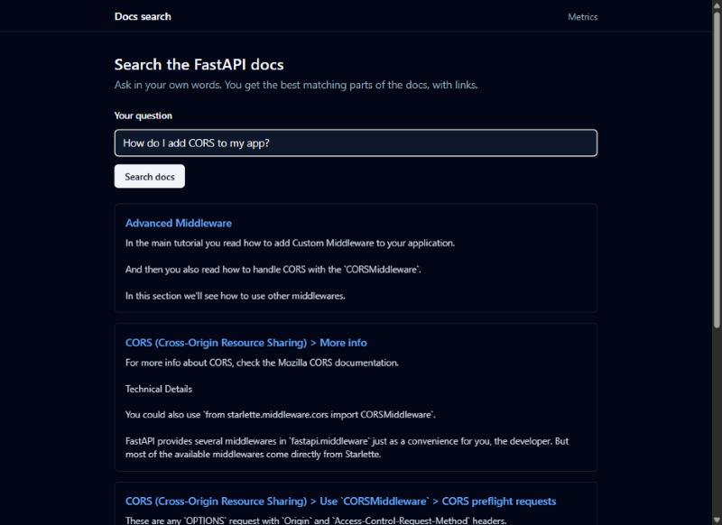
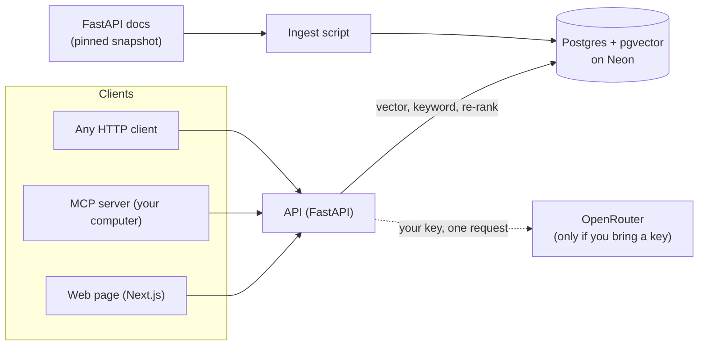
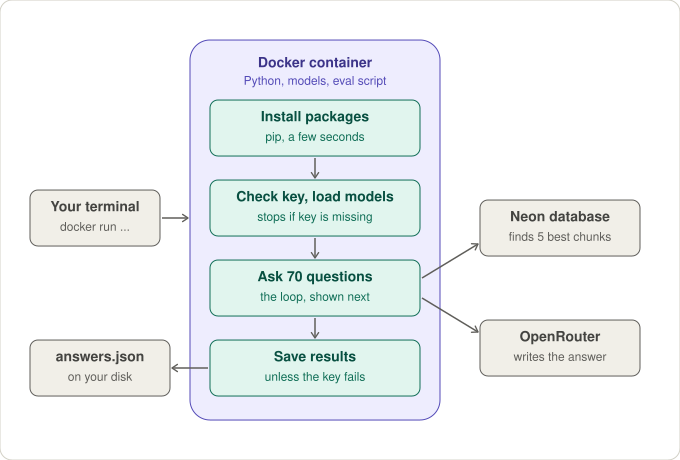
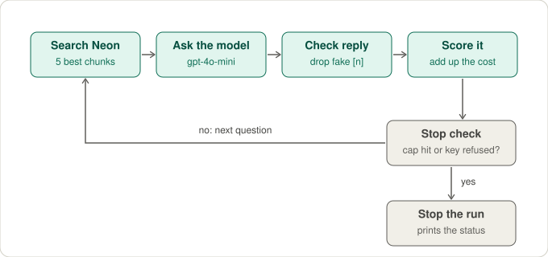

# docs-rag-mcp

[](https://github.com/gayathrip920/docs-rag-mcp/actions/workflows/ci.yml)

Ask questions about the FastAPI docs and get the best matching sections, or a short answer with numbered citations that link back to the source pages.



You can use it three ways:

- a web page for searching, and for written answers if you bring your own key
- an MCP server, so any MCP-compatible tool can search the docs for you
- a plain HTTP API

Contents: [How it fits together](#how-it-fits-together) | [Quick start](#quick-start) | [Search results](#search-results) | [How answers work](#how-answers-work) | [Running the API](#running-the-api) | [Web page](#web-page) | [MCP server](#use-it-as-an-mcp-server) | [Docker](#run-with-docker) | [Kubernetes](#run-on-kubernetes-local-with-kind) | [Public mode](#public-search-only-mode) | [Live demo](#show-it-live-from-your-own-computer) | [Limits](#known-limits) | [Layout](#project-layout)

## How it fits together



- **Ingest** cuts each doc page into chunks that keep their headings, turns each chunk into a vector, and stores both in Postgres.
- **Search** can use vector search, vector plus keyword search, or both followed by a re-ranking model. The rest of this page shows how each one scored.
- **Answers** are optional. The question and the top chunks go to a model on OpenRouter, using a key you provide for that one request.

## Quick start

You need Python 3.12, Docker, and a Postgres database with the pgvector extension (a free Neon project works).

```bash
cp .env.example .env                                   # put your DATABASE_URL in .env
pip install -r requirements.txt -r requirements-ml.txt
python -m rag.ingest                                   # loads and indexes the docs once
docker compose up --build                              # page: http://localhost:3000
```

Then open the page and search. To get written answers, start the API with `ENABLE_ASK=true` (the default) and paste your own OpenRouter key into the page. More detail is in the sections below.

To run the checks on your own computer:

```bash
pip install -r requirements-dev.txt
ruff check . && ruff format --check . && pytest
```

## Bring your own API key

The web app never uses a key stored on the server. You type your own OpenRouter key into the page, and it is used only to answer your question. It is not saved in the database or written to logs.

## Data

The search runs over a pinned snapshot of the FastAPI docs. See [data/SOURCE.md](data/SOURCE.md) for the exact commit and credit.

## Loading the docs into the database

```bash
pip install -r requirements.txt -r requirements-ml.txt
cp .env.example .env     # then put your own DATABASE_URL in .env
python -m rag.ingest
```

The database is Postgres with the pgvector extension, for example a free Neon project. Each page is cut into chunks that keep the page title and heading. Running the command again is safe: unchanged pages are skipped.

To see how the docs get chunked without a database or model, run `python -m rag.ingest --dry-run`.

## Search results

Measured on 2026-11-01 with 60 questions (see `evals/questions.jsonl`). Each question has one correct doc page. The search returns chunks, which are turned into a list of pages.

| Method | recall@5 | MRR@10 | Search time (median / p95) |
|---|---|---|---|
| Vector only | 0.950 | 0.821 | 44 ms / 115 ms |
| Hybrid (vector + keyword) | 0.950 | 0.801 | 140 ms / 214 ms |
| Hybrid + rerank | 0.983 | 0.828 | 3.0 s / 3.6 s |

- recall@5: the share of correct pages found in the top 5 pages.
- MRR@10: the average of 1 divided by the position of the correct page (0 if it is not in the top 10).
- Models: `all-MiniLM-L6-v2` for embeddings and `ms-marco-MiniLM-L-6-v2` for re-ranking. Chunks are up to 300 words with 40 words of overlap.
- Times are for the search step only, on a CPU inside a container. The re-ranker is the slow part.

Things to keep in mind:

- With 60 questions, one question is worth 1.7 points of recall, so small gaps are not strong evidence.
- Adding keyword search did not help here. It matched vector search on recall@5 and was slightly lower on MRR.
- Re-ranking found the correct page for 59 of 60 questions. The one miss is "How do I create my first app and start the development server?", where other pages ranked above the first steps page.
- Full per-question misses are in `evals/results/retrieval.json`. To repeat the run: `python -m evals.run_retrieval_eval`.

## How answers work

1. The question goes through the best search method (hybrid plus re-ranking) and the top 5 chunks are picked.
2. The chunks are shown to the model as numbered sources, with rules: use only the sources, cite them like [1], and reply "Not found in the docs." if the answer is not there.
3. The reply is checked. Citation numbers that do not match a real source are removed and flagged. If nothing is retrieved at all, the model is not called.
4. The time, cost and whether an answer was found are saved in the `queries` table. The question text is saved too, but the API key never is.

The code is in `rag/answer.py` and `rag/llm.py`. The model is reached through OpenRouter, and the key is passed in with each request. It is not read from the server for the web app.

The answer logic is covered by tests that use a fake model, and it has also been scored against the real OpenRouter service. The numbers are in "Answer results" below.

### Measuring answer quality

`evals/run_answer_eval.py` asks all 70 test questions the way the app does, using your own key, and scores the replies:

- **Answered rate:** for questions the docs cover, how often it gave an answer instead of "Not found".
- **Valid citations:** how often the numbers it cited are real sources.
- **Cites the correct page:** how often it cited the page that holds the right answer. A second number counts only the questions where that page was among the 5 chunks the model saw, which separates a search miss from a writing mistake.
- **Correct refusals:** for the 10 questions the docs cannot answer, how often it said "Not found in the docs."
- **Cost and time:** total cost, cost per question, and model time (median and p95).

Run a cheap trial first, then the full run. It stops when the cost reaches `EVAL_MAX_COST_USD` (default 2.00), and it stops straight away if OpenRouter rejects the key.

```bash
export OPENROUTER_API_KEY=your-own-key      # never put it in a file you commit
python -m evals.run_answer_eval --limit 3   # 3 questions of each kind
python -m evals.run_answer_eval             # all 70
```

Results are saved to `evals/results/answers.json`, with the answer text for each question so you can read the misses.

#### What happens during a run

The picture below shows the whole run, here inside a Docker container. The container is only needed if your computer cannot load the model libraries directly. The only parts that cost money are the calls to OpenRouter, and the database is only read, never written.



The "ask 70 questions" step is a loop. For each question the script finds the 5 best chunks, asks the model, removes any citation that does not match a real source, scores the result, and then checks whether to stop. It stops if the cost cap is reached or if OpenRouter refuses the key.



#### Answer results

Measured on 2026-11-07 with `openai/gpt-4o-mini`, using hybrid search plus re-ranking and the top 5 chunks. One run over all 70 questions.

| Check | Result |
|---|---|
| Gave an answer to a question the docs cover | 58 of 60 (96.7%) |
| Citations that point to real sources | 58 of 58 (100%) |
| Cited the page that holds the correct answer | 55 of 60 (91.7%) |
| Same, counting only questions where that page reached the model | 55 of 58 (94.8%) |
| Said "Not found in the docs." for questions the docs cannot answer | 10 of 10 (100%) |
| Cost | $0.017 for all 70, about $0.00024 per question |
| Model time per answer (median / p95) | 2.8 s / 4.2 s |

The five in-scope questions that did not cite the correct page:

- **The right page never reached the model (q01, q42).** The model still wrote a confident answer from the wrong chunks, with real citation numbers. q01 is the same question the search eval missed. This shows that a valid citation does not prove a correct answer.
- **The right page was there, but the model said "Not found" (q14, q59).** This is the model being too careful. Cookies and hiding the docs in production are both covered.
- **The right page was there, but it cited a different page (q18).** The answer may still be fine, but it did not cite the expected page.

Reading these numbers:

- "Cites the correct page" is a stand-in for a good answer. I did not check every answer's wording by hand, so it does not prove the text is right.
- It is one run with one model on 60 questions, so a gap of a few points is not strong evidence.
- The answer step sees 5 chunks, and those can come from fewer than 5 pages. That may be why a few questions miss here that the page-level search table above counts as found.

## Running the API

```bash
pip install -r requirements.txt -r requirements-ml.txt
uvicorn api.main:app --port 8000
```

| Endpoint | What it does |
|---|---|
| `GET /health` | Says the server is up. Does not touch the database. |
| `POST /search` | Returns the best chunks for a query. No API key needed. |
| `POST /ask` | Returns a short answer with citations. Needs your OpenRouter key in the `X-OpenRouter-Key` header. |
| `POST /ask/stream` | Same as `/ask` but streams the answer as it is written. |
| `GET /pages/{path}` | Returns the full text of one doc page. |
| `GET /metrics` | Question count, found rate, latency p50 and p95, and average cost. |

The key is used for that one request only. It is not stored or logged, and the server has no key of its own to fall back on. The key is checked before any searching starts, so requests without one cost almost nothing. Limits and settings are listed below.

## Web page

The page is a small Next.js app in `frontend/`. It sends requests to `/api/...`, and Next forwards them to the Python API, so the browser never talks to the API directly.

```bash
cd frontend
npm install
API_URL=http://localhost:8000 npm run dev    # then open http://localhost:3000
```

- **Search** works for everyone and needs no key. Results link back to the exact doc section.
- **Written answers** appear only when the API has `ENABLE_ASK=true`. The page then shows a box for your own OpenRouter key. The key stays in your browser tab (session storage) and is sent only with your question. It is not saved on the server.
- In the public search-only setup, the key box and the Ask button are hidden.
- Answers are shown as plain text, never as raw HTML. Links are only shown for https addresses.
- `/metrics` shows question count, found rate, latency and cost for answered questions.

`API_URL` is read when the app is built, so set it before `npm run build`.

## Use it as an MCP server

The MCP server lets any MCP-compatible tool search these docs. It runs on your own computer and talks to the search API, so you need the API running first (or a hosted one, set with `DOCS_API_URL`).

```bash
pip install -r requirements-mcp.txt
python -m mcp_server.server        # speaks MCP over stdio
```

Add it to your MCP client's settings. The exact file differs by client, but the entry looks like this:

```json
{
  "mcpServers": {
    "docs-rag": {
      "command": "python",
      "args": ["-m", "mcp_server.server"],
      "cwd": "/path/to/docs-rag-mcp",
      "env": {
        "DOCS_API_URL": "http://localhost:8000",
        "OPENROUTER_API_KEY": "optional, only for ask_docs"
      }
    }
  }
}
```

| Tool | What it does | Needs a key? |
|---|---|---|
| `search_docs(query, k)` | Best matching doc sections with links. `k` is 1 to 20. | No |
| `get_page(path)` | Full text of one page, for example `tutorial/cors.md`. Long pages are cut at 20,000 characters. | No |
| `ask_docs(question)` | Short answer with numbered citations, or "Not found in the docs." | Yes, your own `OPENROUTER_API_KEY` |

`ask_docs` is only offered when `OPENROUTER_API_KEY` is set. It uses your key on your computer. The search API never sees it.

Safety notes:

- All tools are read-only. None can write to a database or read your files.
- Inputs are checked: query length, `k`, and page paths (no `..`).
- Results are plain documentation text. Treat them as data, not instructions.
- Errors show short fixed messages, and the key is never included.

## Run with Docker

```bash
cp .env.example .env          # put your DATABASE_URL in .env
docker compose up --build     # page: http://localhost:3000   API: http://localhost:8000
```

The database stays on Neon. To use a different env file, run `ENV_FILE=.env.reader docker compose up`. For the public search-only setup, use `.env.public.example` (see "Show it live from your own computer").

Notes on the images:

- Both ports are bound to `127.0.0.1`, so other devices on your network cannot reach them directly.

- The API image uses the CPU build of torch and bakes in both models, so a starting container does not need the internet.
- Both images run as a non-root user.
- Secrets are never copied into an image. `.env` files are excluded at build time.

## Run on Kubernetes (local, with kind)

You need `docker`, `kind` and `kubectl`.

```bash
make k8s-up      # makes a local cluster, builds the images, deploys, waits until ready
kubectl -n docs-rag get pods
kubectl -n docs-rag port-forward svc/web 3000:3000    # then open http://localhost:3000
make k8s-down    # removes the cluster
```

### Already have a cluster?

If you turned on Kubernetes in Docker Desktop (or have any other cluster), you do not need `kind`. Build the images, then apply the files yourself:

```bash
make docker-build
kubectl apply -f deploy/k8s/namespace.yaml -f deploy/k8s/configmap.yaml
kubectl -n docs-rag create secret generic docs-rag-secrets \
  --from-literal=DATABASE_URL="$(grep '^DATABASE_URL=' .env.reader | cut -d= -f2-)"
kubectl apply -f deploy/k8s/api-deployment.yaml -f deploy/k8s/api-service.yaml \
  -f deploy/k8s/frontend-deployment.yaml -f deploy/k8s/frontend-service.yaml
kubectl -n docs-rag get pods -w
```

This is the route I tested on Docker Desktop's built-in cluster. Both pods became ready, a search through the page worked, `/ask` was refused as intended, the API ran as a non-root user on a read-only disk, and a deleted API pod was replaced in seconds. To remove it: `kubectl delete namespace docs-rag`.

What is in `deploy/k8s/`:

- `configmap.yaml` holds the public settings (search-only mode and the limits).
- `secret.example.yaml` is an example only. `make k8s-up` creates the real Secret from your local git-ignored file (`.env.reader` by default, change it with `SECRET_ENV_FILE`). Use the read-only database login for it.
- The API and the page each have a Deployment and a Service. Both have readiness and liveness probes. The API also has a startup probe. Containers run as non-root with a read-only filesystem, no extra permissions, and CPU and memory limits.
- The page reaches the API at `http://api:8000`, so keep that Service name.

The manifests are checked against the Kubernetes schemas in CI (`kubeconform`).

## Public search-only mode

For a site anyone can visit, run the API with answers turned off. No AI key is involved, and the slow re-ranking model is never loaded, so it is cheap and hard to abuse.

```bash
ENABLE_ASK=false SEARCH_MODES=vector DEFAULT_SEARCH_MODE=vector RATE_LIMIT_PER_MIN=30 GLOBAL_RATE_LIMIT_PER_MIN=200 MAX_CONCURRENT_SEARCHES=2 uvicorn api.main:app --port 8000
```

| Setting | What it does | Default |
|---|---|---|
| `ENABLE_ASK` | Turns `/ask` and `/ask/stream` on or off | `true` |
| `SEARCH_MODES` | Which search methods visitors may use (`vector`, `hybrid`, `hybrid_rerank`) | all three |
| `DEFAULT_SEARCH_MODE` | Method used when a request does not name one | `hybrid_rerank` |
| `RATE_LIMIT_PER_MIN` | Calls per minute for each visitor | `30` |
| `GLOBAL_RATE_LIMIT_PER_MIN` | Calls per minute for all visitors together (0 means off) | `0` |
| `MAX_CONCURRENT_SEARCHES` | Searches allowed at the same time. Extra ones get a polite "busy" reply | `4` |
| `POOL_MAX` | Most database connections kept open | `5` |
| `CORS_ORIGINS` | Websites allowed to call the API from a browser | `http://localhost:3000` |

`GET /config` tells the web page what is turned on. In public mode, a quick test on a laptop used about 470 MB of memory.

Behind a proxy or ingress, every visitor can look like the same address. Start uvicorn with `FORWARDED_ALLOW_IPS` set to your proxy's address so the per-visitor limit sees the real visitor.

### Use a read-only database login

The API only needs to read pages and write the query log. `deploy/sql/readonly_role.sql` creates a login for that. Run it once as the owner with a strong password, then use that login in the API's `DATABASE_URL`. Keep the owner login for `rag.ingest` only.

## Show it live from your own computer

There is no always-on hosted copy. To let someone try it, for example in an interview, you can run it on your computer and share a temporary public link. It uses the search-only setup, so there is no AI key involved and visitors cannot run up a bill.

1. Make your settings file and put the **read-only** database login in it:

   ```bash
   cp .env.public.example .env.public     # then set DATABASE_URL to the read-only login
   ```

2. Start the app with those settings:

   ```bash
   ENV_FILE=.env.public docker compose up --build        # PowerShell: $env:ENV_FILE=".env.public"; docker compose up --build
   ```

   Open http://localhost:3000 and try a search first. The very first search is slow while the model loads.

3. Open a tunnel to the web page only. A tunnel tool such as Cloudflare's `cloudflared` gives you a random https link that works while the tool is running:

   ```bash
   cloudflared tunnel --url http://localhost:3000
   ```

4. Share the link it prints. When you are done, press Ctrl+C in the tunnel window and run `docker compose down`. The link stops working at once.

What keeps this safe:

- Only port 3000 (the web page) is tunneled. The API port is never exposed, and both ports listen on localhost only.
- Writing answers is switched off, and only the fast vector search is allowed.
- The database login is read-only, so a visitor cannot change or delete data.
- Limits cap how many searches run at once and how many are allowed per minute.

Things to know:

- Through a tunnel every visitor looks like the same address to the API, so the per-visitor limit acts as one shared limit. The overall cap still protects you.
- Anyone with the link can search and can see the `/metrics` page. Do not leave it running unattended.
- I tested everything up to the tunnel step with this exact settings file. I have not run a tunnel tool with this project, and the tool itself is a separate download.

## Test questions

`evals/questions.jsonl` has 60 questions, each with the doc page that answers it. `evals/out_of_scope.jsonl` has 10 questions the docs cannot answer, used to check that the app says "not found". Run `python evals/check_questions.py` to confirm every listed page exists.

## Known limits

I would rather list these here than have you find them.

- **Answer quality is measured only roughly.** The answer eval checks that citations are real and that the right page is cited, not that every sentence is correct. It is one run with one model (see "Answer results"). A confident answer from the wrong chunks can still pass the citation check.
- **Small test set.** 60 questions, each with one correct page. That is enough to compare methods roughly, not to prove small differences.
- **One doc set, frozen.** It covers one pinned snapshot of the FastAPI docs, in English. It does not update itself.
- **Re-ranking is slow on a CPU.** About 3 seconds a search in my runs, which is why the public setup uses vector search only.
- **Rate limits live in memory.** They are counted per API process, so they reset on restart and are not shared if you run more than one copy. The Kubernetes files run one copy of each.
- **Kubernetes was tried on one local cluster only.** The manifests pass a strict schema check in CI and ran on Docker Desktop's built-in cluster. The `make k8s-up` script, which uses `kind`, has not been run, and nothing has been tried on a cloud cluster.
- **Not hosted.** There is no always-on demo link. You can show it live from your own computer (see "Show it live from your own computer"). The API image is about 2.5 GB because it carries two models, and it needs roughly 0.5 GB of memory in search-only mode.
- **Questions are logged.** The text of each question, its timing and its cost go to the `queries` table so `/metrics` can work. API keys are never stored.

## Project layout

```text
api/          FastAPI app: search, ask, pages, metrics, limits
rag/          chunking, embeddings, database, search, answers, OpenRouter client
mcp_server/   the MCP server and its small client for the API
frontend/     Next.js web page
evals/        test questions, metrics and the retrieval eval
data/         the pinned FastAPI docs snapshot and its credit
deploy/       Dockerfiles, Kubernetes files, read-only database role
tests/        unit tests (no database or model needed)
docs/         images used in this README
```

## License

MIT. See [LICENSE](LICENSE). The FastAPI docs in `data/` keep their own MIT license and credit, in [data/LICENSE-fastapi](data/LICENSE-fastapi).
